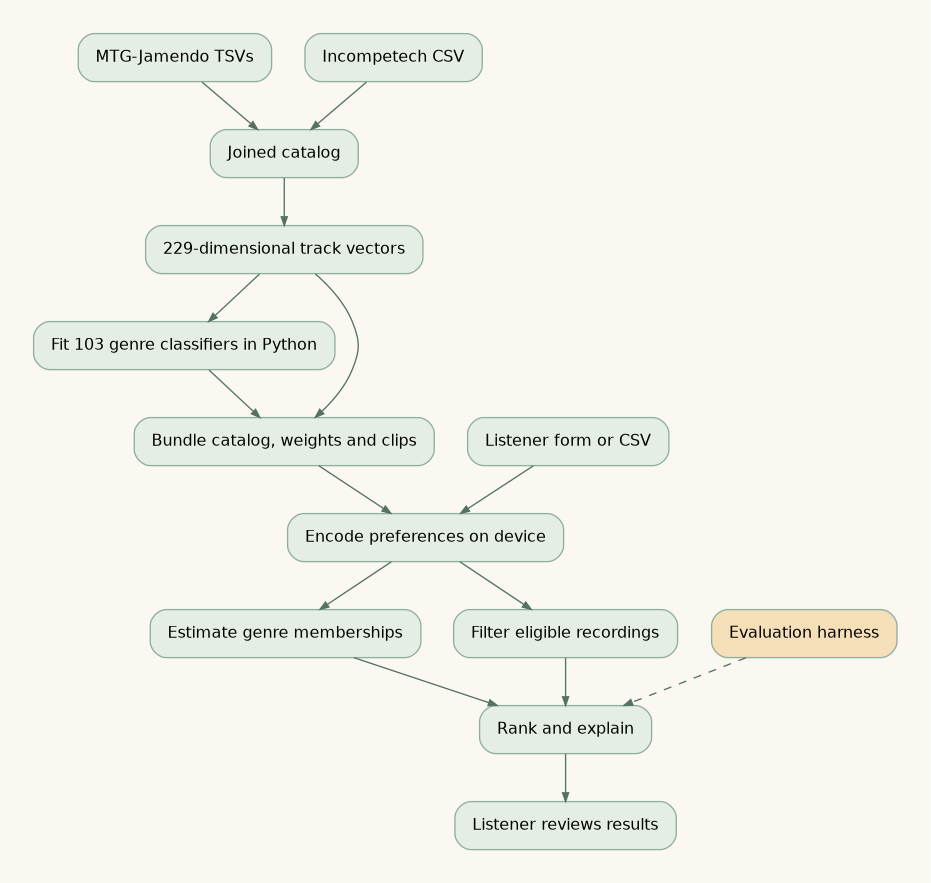

# CueCrate Mobile

Download **CueCrate_Movil.html** and open the saved file in a browser with JavaScript. Everything needed for recommendation and the 28 audio previews is embedded in the file. No Python installation, API key, network connection or server is required on the phone. A file preview that disables scripts cannot run this app.

## Base project and design

The Module 3 **Music Recommender Simulation** ranked 18 hand-written tracks from a taste profile and explained its scoring rules. This edition keeps the idea of user-entered preferences and implements a compact supervised model, CSV ingestion, on-device ranking, offline playback and reproducible checks. [Original project](https://github.com/dreuxx/ai110-module3show-musicrecommendersimulation-starter).

## Try it

Tap **Probar hip hop con bajo**. The first result is *Big Plans Remix* by Kellee Maize. Open its score, then select **Usar como perfil** to find neighbors that share its genre vector. For reggae, import [preferencias.csv](data/preferencias.csv) and choose **Reggae con guitarra**. Choose **Escuchar sin internet** to hear a locally bundled excerpt.

## Catalog and features

The app searches 56,656 recordings across 3,548 source artist IDs and 103 genre labels. It combines 55,213 recordings from MTG-Jamendo on Hugging Face with the previous 1,443-track Incompetech collection. The importer keeps all available genre labels and requires an artist name and a title. Of the Jamendo rows with genre tags, two lacked usable names. 43,492 included recordings belong to multiple genres. Counts by genre therefore overlap. Only the 28 original Incompetech previews are bundled. Jamendo detail pages can be opened online.

| File | How to use it |
| --- | --- |
| [tracks.csv](data/tracks.csv) | One row per recording with source ID, artist ID and display name, title, genre memberships, instrument and mood tags, BPM when known, and source URL. |
| [tracks_by_genre.csv](data/tracks_by_genre.csv) | One row per genre membership, sorted by genre, artist and title. A track can appear under several genres. |
| [genres.csv](data/genres.csv) | Per-genre track and artist counts. |
| [song_vectors.csv](data/song_vectors.csv) | One numerical vector per recording, represented by zero-based indices and matching values. Unlisted coordinates are zero. |
| [vector_dimensions.json](data/vector_dimensions.json) | Ordered names of all 229 dimensions. Use `python tools/vector.py TRACK_ID --dense` for an ordinary array. |
| [provenance.json](data/provenance.json) | Source revisions, checksums and credits. See also [data attribution](DATA_LICENSES.md). |

For example, `python tools/vector.py track_0521030` decodes *Big Plans Remix*:

```json
{"genre:Electronic": 1.0, "genre:Hip Hop": 1.0, "genre:Pop": 1.0, "mood:Happy": 1.0, "instrument:Bass": 1.0}
```

The other 224 coordinates are zero. The [full audit](evidence/vector_audit.txt) compares the CSV vectors, genre memberships and credited artist names against the mobile index.

## Architecture and scoring

A song's 229-dimensional vector has **103 genre flags, 70 mood/theme coordinates, 53 instrument coordinates and three tempo coordinates**. Mood and instrument blocks are normalized separately. The tempo block uses Gaussian distances from 65, 115 and 165 BPM. Unknown tempo leaves three zeros. Missing tags mean the source did not provide the information.

On a computer, Python trains 103 independent regularized logistic classifiers on the 126 non-genre features. Genre indicators are targets and are excluded from classifier inputs. On the phone, a form or CSV creates a preference vector in the same space. Inference takes one matrix-vector product and one sigmoid per genre. A recording can match multiple labels. Artist, title and play counts are excluded from training.

A selected genre filters candidates exactly. Remaining tracks are compared by mood cosine (weight 3), instrument cosine (3), a tempo Gaussian with width 25 BPM (1.5), and a learned genre compatibility term (1, when mood or instruments were requested). With no fixed genre, that last term takes the highest estimated genre likelihood among the track’s labels, divided by the highest estimate for the profile. With a fixed genre it is constant across eligible tracks. A song used as a seed adds cosine similarity across genre flags (weight 2) and excludes the same artist/title family. Only active signals enter the weighted mean. Within score ties, the ranker prioritizes distinct artists. Scores describe agreement with features. Listener preference requires a separate evaluation.

When a numeric tempo is requested, only the 1,196 tracks with measured or supplied BPM are eligible. MTG-Jamendo's two selected files do not supply BPM. Strict matching requires all selected tags. An empty profile, unknown CSV label, or impossible combination yields actionable feedback.



[Mermaid source](diagrams/architecture.mmd) · [Model card](model_card.md) · [Project decisions](ai_interactions.md).

## Reproduce

Open the bundled HTML directly for offline use. Developers can rebuild from the checked-in combined CSV using Python 3.12, NumPy 2.3.5, SciPy 1.17.0 and Node 22+. To regenerate the CSV from its sources first, run `python tools/catalog.py /path/to/cache` (requires network only if the pinned TSVs are absent).

```bash
python -m pip install -r requirements.txt
python tools/train.py
python tools/build.py
python tests/check_vectors.py
node tests/evaluate.cjs --write
```

Optional browser test from the project root:

```bash
npm install --no-save playwright@1.62.1
npx playwright install chromium
node tests/browser.mjs
```

## Measured examples

The command `node tests/evaluate.cjs --write` exercises the app's actual ranking code. Excerpts from [the execution log](evidence/demo.txt):

```text
Hip hop with bass: Big Plans Remix, Smooth casual, End Of Times
Reggae with guitar: Condition Humaine, Hypnotic reagge, Age
Jazz with piano: Night on the Docks - Piano, Voyageur, When I Was With You
```

```text
Study jazz: Samba Isobel, Ultralounge, Bass Vibes
Workout rock: Neolith, Metalmania, Cool Rock
Empty: empty; Urban + Harpsichord (strict): no_match
```

## Reliability

The classifier experiment fits 28,099 tracks from 1,870 artist IDs and evaluates 5,975 tracks from 447 disjoint artist IDs. Tracks without any non-genre signal are excluded from classifier fitting and evaluation. A prediction is a hit if it matches any annotated genre. Top-1 hits were **3,025/5,975 (50.6%)** and top-3 hits were **4,268/5,975 (71.4%)**. Always predicting the most frequent training genre gave **1,912/5,975 (32.0%)**. The shipped classifier is refit on all 34,074 usable tracks. [Held-out predictions](evidence/holdout.csv) · [Aggregate counts](evidence/classifier.json).

On 19 scripted preference profiles both direct and model-assisted ranking met the metadata criteria in 57/57 top-three positions. Adding the model changed four first choices. The harness also checked all 103 genre filters, seeded recommendations, bounds, empty input and impossible requests. The [browser test](evidence/browser.json) passed 18 checks in offline Chromium with touch emulation, including artist display, Jamendo URLs, CSV import, embedded playback, three viewport widths and zero network requests. Physical phones and listener satisfaction remain untested. [Profile-level outcomes](evidence/ranking.json).

## Reflection and portfolio

Working with songs that have several genres changed both the data structure and the evaluation. A rock-and-reggae recording needs to be retrievable under either label. The project demonstrates data integration, supervised learning, on-device ranking and artist-disjoint evaluation. The owner will add the final public repository URL after publishing. [Six-minute presentation](presentation/Walkthrough.pdf) · [Spanish instructions and GitHub steps](INICIO_ES.md).
